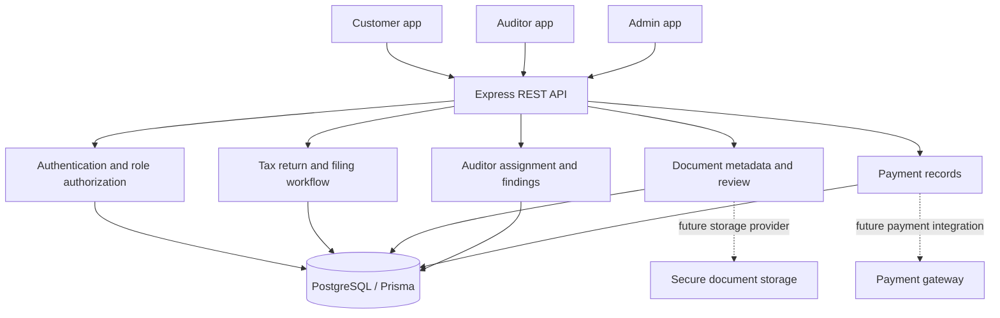

# Architecture overview

The API is a modular monolith. Prisma models users, customer and auditor profiles, financial years, tax returns, income, deductions, tax computations, documents, audit assignments/findings/reports, filing history, and payment records.

## Tax-return lifecycle
1. A customer creates a draft for an active financial year and adds income, deductions, and document metadata.
2. The customer submits the draft for review.
3. An admin assigns a verified, available auditor.
4. The auditor records findings, requests changes, or approves/rejects the return; status changes are stored in filing history.
5. An auditor or admin records tax-computation values. An admin advances an approved return through ready-to-file, filed, verified, and completed statuses.
6. Payments are stored as pending records until an admin records their outcome. The starter does not charge funds or integrate a payment gateway.

This project does not upload documents, implement a tax rules engine, or submit returns to a government filing portal.
